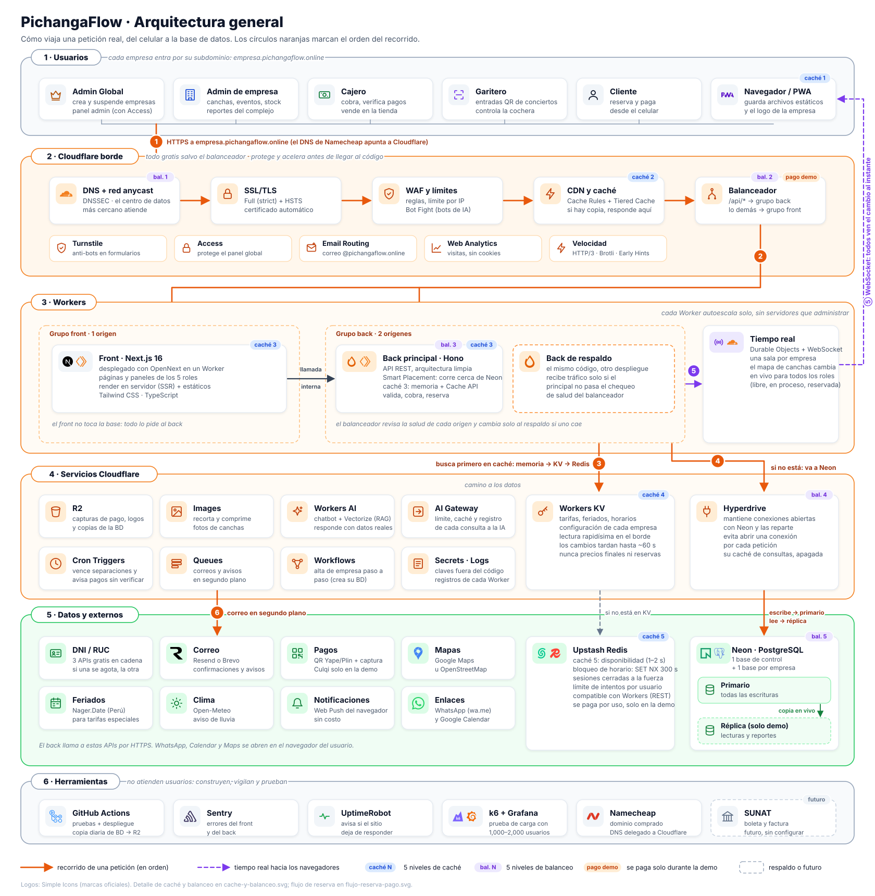
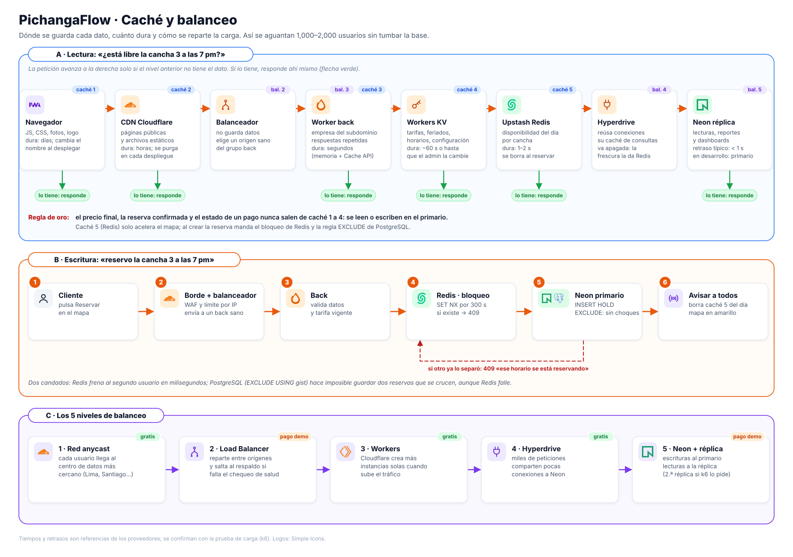
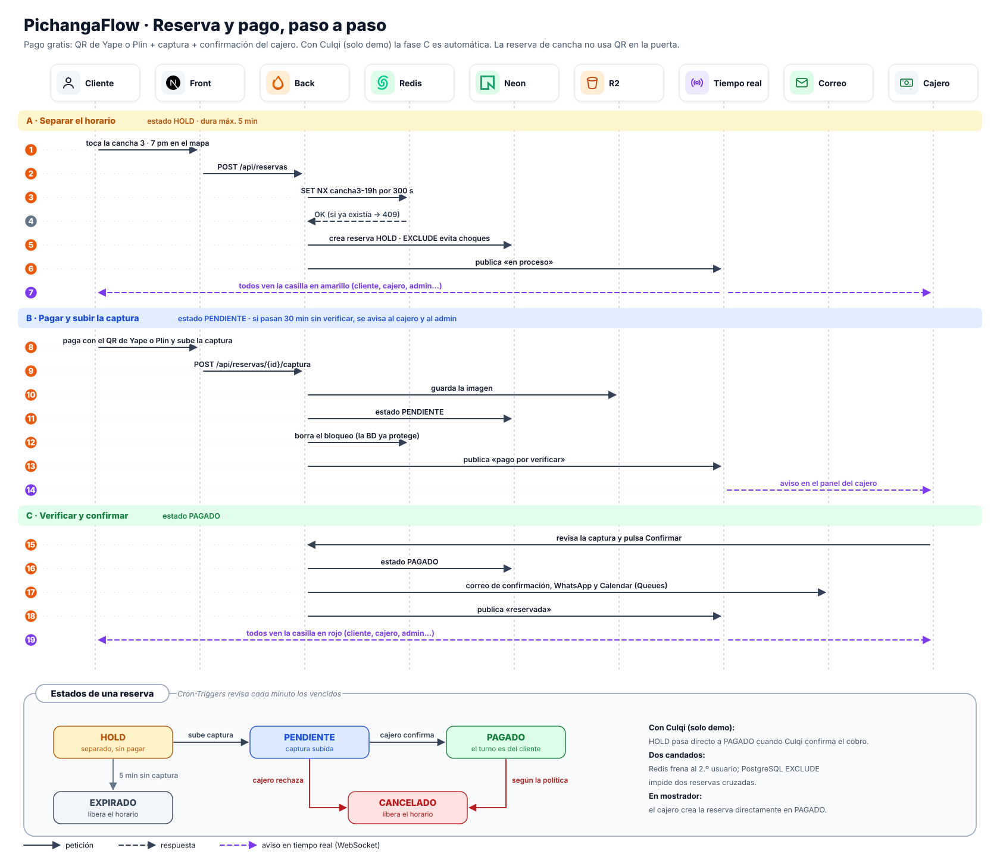
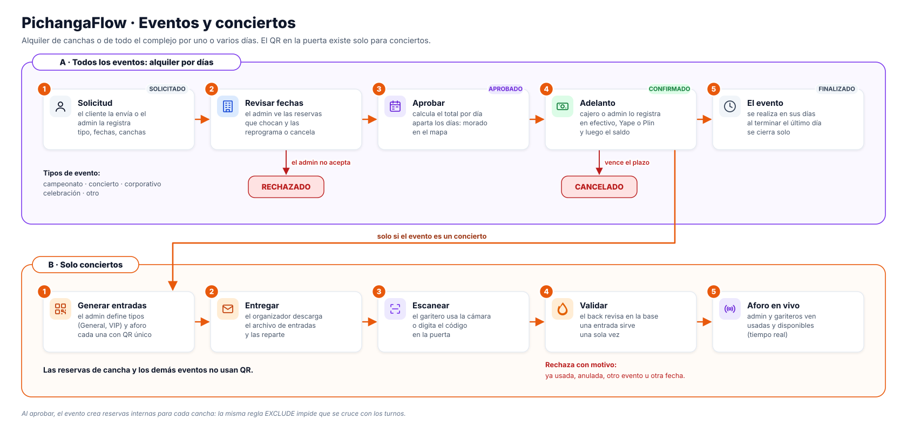

# Arquitectura

Cómo funciona PichangaFlow por dentro. Todo corre en Cloudflare, salvo la base de datos (Neon) y la caché compartida (Upstash Redis).

## 1 · Vista general



### El recorrido de una petición (los números del diagrama)

1. **El usuario entra** a `empresa.pichangaflow.online`. El DNS de Cloudflare lo envía al centro de datos más cercano. Allí se aplican SSL, WAF, límites y caché del CDN. Si el CDN tiene la página o el archivo, responde ahí mismo.
2. **El balanceador elige el destino según la ruta.** `/api/*` va al grupo back y todo lo demás al grupo front. En cada grupo usa solo los orígenes que pasan el chequeo de salud.
3. **El back busca primero en caché**: memoria del Worker, luego KV y luego Redis.
4. **Si el dato no está en caché, va a Neon por Hyperdrive.** Las escrituras van al primario y los reportes a la réplica.
5. **El back publica el cambio** en el Durable Object de la empresa, que lo envía por WebSocket a todos los navegadores conectados.
6. **Lo lento va a una cola** (correo, avisos) y se hace en segundo plano, sin hacer esperar al usuario.

## 2 · Front y back

| | Front (`apps/web`) | Back (`apps/api`) |
|---|---|---|
| Qué es | Next.js 16 adaptado con OpenNext | API REST con Hono |
| Dónde corre | Un Worker | Un Worker con Smart Placement (se ubica cerca de Neon) |
| Qué hace | Páginas y paneles de los 5 roles, render en servidor y archivos estáticos | Reglas de negocio, datos, pagos, tiempo real, IA |
| Habla con | Solo con el back (llamada interna o `/api`) | Neon, Redis, KV, R2, Queues, Workers AI y APIs externas |

**No hay servidores que administrar.** Cada Worker escala solo: con 10 o con 2,000 usuarios es el mismo despliegue (balanceo 3).

### El balanceador (solo en la demo)

Es un solo Load Balancer de Cloudflare con dos grupos (pools):

| Ruta | Grupo | Orígenes | Si uno falla |
|---|---|---|---|
| `/api/*` | Grupo back | Back principal + Back de respaldo (el mismo código, otro despliegue) | El chequeo de salud (`GET /api/salud`) lo detecta y todo va al respaldo (RNF-DIS-02) |
| Todo lo demás | Grupo front | Front | Se puede agregar un respaldo igual si la prueba de carga lo pide |

Son 3 orígenes en total. Fuera de la demo, el balanceador se apaga y las rutas de Workers (`*.pichangaflow.online/*` → front, `*.pichangaflow.online/api/*` → back) hacen el mismo reparto gratis, sin respaldo.

**Por verificar al configurarlo**: que cada Worker se publique con un hostname propio para usarlo como origen, y que el balanceador conserve el `Host` original, porque la empresa se reconoce por el subdominio.

## 3 · Caché y balanceo



| Caché | Dónde | Qué guarda | Dura |
|---|---|---|---|
| 1 | Navegador | JS, CSS, fotos y logo | Días (el nombre del archivo cambia en cada despliegue) |
| 2 | CDN de Cloudflare | Páginas públicas y estáticos | Horas; se purga al desplegar |
| 3 | Memoria del Worker y Cache API | Empresa del subdominio, respuestas repetidas | Segundos |
| 4 | Workers KV | Configuración, tarifas, horarios y feriados | Hasta que el admin los cambie (≈ 60 s en propagarse) |
| 5 | Upstash Redis | Disponibilidad del día por cancha | 1–2 s; se borra al reservar |

**Nunca salen de caché** el precio final, la reserva confirmada, el estado de un pago, el stock al vender ni la validación de una entrada (principio V). La caché de consultas de Hyperdrive va apagada: la frescura la controla Redis.

| Balanceo | Qué reparte | Costo |
|---|---|---|
| 1 · Red anycast | Usuarios entre centros de datos de Cloudflare | Gratis |
| 2 · Load Balancer | Peticiones entre orígenes, con respaldo | Pago, solo demo |
| 3 · Workers | Instancias que se crean solas según el tráfico | Gratis (Paid en la demo) |
| 4 · Hyperdrive | Miles de peticiones sobre pocas conexiones a Neon | Gratis |
| 5 · Neon primario + réplica | Escrituras al primario, lecturas a la réplica | Réplica de pago, solo demo |

## 4 · Multiempresa

1. El back lee el subdominio de la petición (`canchaslima.pichangaflow.online` → `canchaslima`).
2. Busca la empresa en la caché (memoria → KV) o en la base de control. Si está suspendida, responde con el aviso (RF-AG-04).
3. Abre la conexión a la base de esa empresa (`pf_canchaslima`) por Hyperdrive y fija la empresa en la sesión de PostgreSQL para las políticas RLS.
4. Todo lo que pasa después ocurre dentro de esa base. Las claves de Redis, KV, R2 y Vectorize también empiezan con el id de la empresa.

El detalle de las bases está en [base-de-datos.md](base-de-datos.md).

## 5 · Arquitectura limpia del back

```text
apps/api/src/
├── domain/          Entidades y reglas puras: Reserva, Evento, Tarifa, Turno de caja, Venta
├── application/     Casos de uso (SepararHorario, ConfirmarPago…) y puertos (interfaces)
├── infrastructure/  Adaptadores: Neon, Redis, KV, R2, Workers AI, correo, DNI, Culqi
└── interface/       Rutas HTTP de Hono, WebSocket, validación con Zod
```

- Las dependencias apuntan hacia adentro: `interface` → `application` → `domain`. `infrastructure` implementa los puertos de `application`.
- Una regla automática de importaciones hace fallar el CI si alguien la rompe (RNF-CAL-05).
- Gracias a los puertos, las pruebas unitarias usan dobles en memoria y las de integración usan servicios reales.

## 6 · Reserva y pago



- **Dos candados contra la sobreventa.** Redis (`SET NX`, 300 s) frena al segundo usuario en milisegundos. PostgreSQL (`EXCLUDE USING gist`) hace imposible guardar dos reservas cruzadas, aunque Redis falle.
- **Pago gratis.** El cliente paga con QR de Yape o Plin y sube la captura. El cajero la verifica y confirma con un botón.
- **Pago de demo.** Con Culqi, el cobro se aprueba y la reserva pasa directo a PAGADO.
- **Tareas programadas.** Cron Triggers vence cada minuto las separaciones sin captura y avisa de los pagos con más de 30 minutos sin verificar.

## 7 · Eventos y conciertos



- **Alquiler por días.** Es distinto de la reserva por turnos: el cliente lo solicita y el admin lo aprueba, cobra un adelanto y aparta los días.
- **Sin choques.** Al aprobar, el evento crea reservas internas para cada cancha, así la misma regla `EXCLUDE` impide que se crucen con turnos.
- **QR solo en conciertos.** Únicamente un concierto genera entradas con QR, que el garitero escanea en la puerta. Las reservas de cancha y los demás eventos no usan QR.

## 8 · Tienda

- **Solo para el personal.** El cajero arma un carrito en su panel; el cliente no compra productos en línea.
- **Tres formas de agregar.** Escáner de código de barras (cámara o lector USB), búsqueda por nombre o código digitado.
- **Stock exacto.** Cada venta descuenta el stock en la base principal, y el admin ve el cambio en vivo. Dos cajeros no pueden vender la misma última unidad.

## 9 · Seguridad en capas

| Capa | Protección |
|---|---|
| Borde | SSL Full (strict) + HSTS · WAF · límite por IP · Bot Fight · Turnstile · Access para el panel global |
| Back | Sesión en cookie segura · rol y empresa validados en cada ruta · entradas validadas con Zod · límites por usuario en Redis |
| Datos | Una base por empresa + RLS · capturas en R2 privado con enlace firmado · auditoría de solo inserción |
| Secretos | Cloudflare Secrets en producción y `.dev.vars` local, fuera de git |

## 10 · Entornos

| Entorno | Dónde | Qué se paga |
|---|---|---|
| Local | `wrangler dev` (front y back) + rama de Neon de desarrollo + Upstash Free | Nada |
| Producción | Cloudflare Free + Neon Free + Upstash Free | Nada |
| Demo y prueba de carga | Lo mismo + Workers Paid, Load Balancer, réplica de Neon, Upstash por uso y Culqi | ≈ US$ 22–35 el mes de la demo ([tecnologias.md](tecnologias.md)) |

**Despliegue.** GitHub Actions corre las pruebas y despliega cada Worker con Wrangler al integrar en `main`. Cada día guarda una copia de las bases en R2.

**Tareas manuales del equipo.** Configurar Cloudflare, Neon, Upstash y el dominio, y activar o apagar lo que se paga.

## 11 · Decisiones

| Decisión | Alternativa descartada | Por qué |
|---|---|---|
| Todo en Cloudflare Workers | VPS con Docker o Kubernetes | Escala solo, gratis para desarrollo, sin servidores que mantener; el balanceo y la caché ya vienen en la red |
| Neon (PostgreSQL) | Cloudflare D1 | Necesitamos `EXCLUDE` con rangos, RLS, réplicas de lectura y bases separadas por empresa |
| Una base por empresa + base de control | Una sola base con columna de empresa | Aislamiento fuerte, copias y borrado por empresa; RLS queda como segunda barrera |
| Hono en el back | NestJS / Express | Hecho para Workers, liviano y con validación y OpenAPI integradas |
| Upstash Redis | Redis propio en un servidor | Funciona por HTTP desde Workers y se paga por uso |
| Durable Objects para tiempo real | Servicio externo de WebSocket | Nativo de Cloudflare, una sala por empresa, gratis en desarrollo |
| PBKDF2 con Web Crypto | Librería externa de autenticación | Sin dependencias, nativo de Workers; el tope de 100,000 iteraciones cumple RNF-SEG-02 |
| Pago por QR + captura | Solo pasarela de pago | Gratis; Culqi se activa únicamente en la demo |
| Un Load Balancer con regla por ruta | Un balanceador para el front y otro para el back | Una sola suscripción; separa front y back por ruta |
| QR en la puerta solo para conciertos | QR en todas las reservas | En un turno de cancha es un paso innecesario; en un concierto sí hay que controlar entradas y aforo |

## 12 · Por verificar antes de construir

- Que el rol de Neon permita `CREATE DATABASE` desde el Workflow de alta de empresa, o si se usa la consola de Neon.
- Workers como orígenes del Load Balancer y conservación del `Host` original.
- Cuotas vigentes de los planes gratis (Workers, Queues, Hyperdrive, Workers AI, Upstash) y de las 3 APIs de DNI.
- Precio final del Load Balancer por origen extra y de la réplica de Neon.
