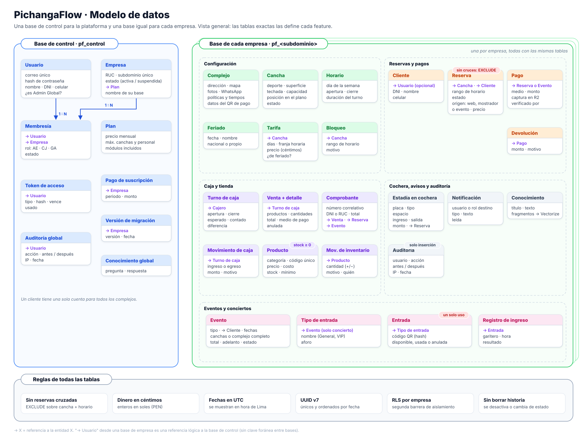

# Base de datos

Diseño general, sin código: qué bases hay, qué guarda cada una y qué reglas cumplen. Las tablas exactas y las migraciones las define cada feature en su `data-model.md` (`/speckit-plan`) y viven en `db/migrations/`.

## Dónde vive cada dato

| Lugar | Qué guarda | Dura |
|---|---|---|
| **Neon: base de control** (`pf_control`) | Usuarios, empresas, membresías, planes y auditoría global | Permanente |
| **Neon: base de cada empresa** (`pf_<subdominio>`) | Todo lo que opera el complejo: canchas, reservas, eventos, pagos, caja, tienda, cochera | Permanente |
| **Upstash Redis** | Bloqueos de horario, disponibilidad del día, sesiones revocadas, intentos fallidos | De 1 s a 30 días, siempre con vencimiento |
| **Workers KV** | Configuración, tarifas y feriados ya calculados por empresa | Hasta que cambian (≈ 60 s en propagarse) |
| **R2** | Capturas de pago, logos, fotos y copias diarias de las bases | Capturas: 1 año · copias: 30 días |
| **Vectorize** | Fragmentos del conocimiento del chatbot, separados por empresa | Hasta que el admin los cambia |

Redis y KV son solo caché: si se borran, todo se reconstruye desde Neon.

## Base de control

| Entidad | Qué representa | Datos principales |
|---|---|---|
| Usuario | Toda persona con cuenta: Admin Global, personal y clientes | Correo único, hash de contraseña, nombre, DNI, celular, correo verificado, estado, si es Admin Global |
| Empresa | Un complejo deportivo cliente del SaaS | Nombre, RUC, subdominio único, estado (activa o suspendida), plan, nombre de su base, logo y colores |
| Membresía | Qué rol tiene un usuario en una empresa | Usuario, empresa, rol (Admin de empresa, Cajero o Garitero), estado |
| Plan | Lo que incluye cada suscripción | Nombre, precio mensual, máximo de canchas y de personal, módulos |
| Pago de suscripción | Cobro mensual a la empresa | Empresa, periodo, monto, fecha, registrado por |
| Token de acceso | Enlaces de un solo uso: confirmar correo, invitación, recuperar contraseña | Usuario, tipo, hash del token, vence, usado |
| Versión de migración | Qué migración tiene aplicada cada base de empresa | Empresa, versión, fecha |
| Auditoría global | Acciones del Admin Global y accesos | Usuario, acción, antes y después, IP, fecha |
| Conocimiento global | Preguntas frecuentes de la plataforma para el chatbot | Pregunta, respuesta |

Un cliente tiene **una sola cuenta** (Usuario) para todos los complejos. El personal es Usuario con Membresía en su empresa.

## Base de cada empresa

**Configuración**

| Entidad | Qué representa | Datos principales |
|---|---|---|
| Complejo | Perfil público y políticas (una fila) | Dirección y coordenadas, fotos, WhatsApp, servicios, tiempo de separación, plazo de aviso, plazo de cancelación, adelanto de eventos, datos del QR de pago |
| Cancha | Cada cancha | Nombre, deporte, superficie, techada, capacidad, posición en el plano, estado |
| Horario de operación | Cuándo abre cada día | Día de la semana, apertura, cierre, duración del turno |
| Tarifa | Precio por franja | Cancha, días, hora desde y hasta, precio en céntimos, si es de feriado |
| Feriado | Días con tarifa especial o cierre | Fecha, nombre, origen (nacional o propio) |
| Bloqueo | Horario no reservable | Cancha, rango de fecha y hora, motivo |

**Reservas y pagos**

| Entidad | Qué representa | Datos principales |
|---|---|---|
| Cliente | Persona que reserva en esta empresa, con o sin cuenta | Usuario (si tiene cuenta), DNI, nombre, celular |
| Reserva | Un turno en una cancha | Cancha, cliente, rango de fecha y hora, estado, precio en céntimos, origen (web, mostrador o evento), creada por |
| Pago | Cada pago de una reserva o de un evento | Reserva o evento, medio (Yape, Plin, efectivo, Culqi), monto, ruta de la captura en R2, número de operación, estado, verificado por y cuándo |
| Devolución | Dinero devuelto | Pago, monto, motivo, quién la hizo |

**Eventos y conciertos**

| Entidad | Qué representa | Datos principales |
|---|---|---|
| Evento | Alquiler por uno o varios días | Tipo (campeonato, concierto, corporativo, celebración, otro), cliente, fechas, canchas o complejo completo, asistentes, total, adelanto, estado, aprobado por |
| Tipo de entrada | Solo conciertos | Evento, nombre (General, VIP), aforo |
| Entrada | Solo conciertos: una por persona | Tipo de entrada, código QR (hash), estado (disponible, usada o anulada) |
| Registro de ingreso | Cada escaneo en la puerta del concierto | Entrada, garitero, fecha y hora, resultado |

**Caja y tienda**

| Entidad | Qué representa | Datos principales |
|---|---|---|
| Turno de caja | Apertura y cierre de un cajero | Cajero, apertura, cierre, monto inicial, esperado y contado por medio de pago, diferencia |
| Movimiento de caja | Ingreso o egreso fuera de ventas | Turno, tipo, monto, motivo |
| Producto y Categoría | Lo que se vende en la tienda (gaseosas, aguas, cervezas, galletas…) | Nombre, categoría, código único, precio, costo, foto, stock, stock mínimo, activo |
| Movimiento de inventario | Entradas, ventas y ajustes | Producto, cantidad (+/−), motivo, quién |
| Venta y Detalle de venta | Un carrito cobrado en la tienda | Turno, cliente opcional, reserva opcional, productos, cantidades, total, medio de pago, estado (anulada o no) |
| Comprobante | Comprobante interno (no SUNAT) | Número correlativo, DNI o RUC, nombre o razón social, total, venta, reserva o evento |

**Cochera, avisos y auditoría**

| Entidad | Qué representa | Datos principales |
|---|---|---|
| Estadía en cochera | Un vehículo dentro del complejo | Placa, tipo, espacio, ingreso, salida, monto, reserva asociada |
| Notificación | Avisos de la campana | Usuario o rol destino, tipo, texto, leída |
| Conocimiento | Información del complejo para el chatbot | Título, texto (sus fragmentos van a Vectorize) |
| Auditoría | Cambios de dinero, precios y permisos | Usuario, acción, entidad, antes y después, IP, fecha |

## Reglas que cumplen todas las tablas

1. **Ninguna reserva cruzada.** Una restricción `EXCLUDE` sobre cancha y rango de horario impide dos reservas solapadas mientras estén en HOLD, PENDIENTE o PAGADO. Al aprobar un evento se crea una reserva de origen "evento" por cada cancha y rango, así la misma regla lo protege. Es la última defensa contra la sobreventa (principio V).
2. **Dinero en céntimos.** Montos enteros en soles (PEN); nunca decimales flotantes.
3. **Fechas en UTC.** Se guardan con zona horaria y se muestran en hora de Lima.
4. **Identificadores UUID v7.** Son únicos entre empresas y se ordenan por fecha de creación.
5. **Segunda barrera por empresa.** Cada tabla de empresa lleva el id de la empresa y una política RLS que solo deja ver las filas de la empresa de la conexión.
6. **Sin borrar historia.** Catálogos (canchas, productos, personal) se desactivan, no se borran. Reservas, pagos y ventas solo cambian de estado. La auditoría solo admite inserciones.
7. **Estados controlados.** Los estados de reserva, pago y evento solo cambian según las tablas de [requisitos-funcionales.md](requisitos-funcionales.md#estados-de-una-reserva).
8. **Datos personales mínimos.** El DNI se guarda una vez por persona y se muestra enmascarado a quien no lo necesita (RNF-PRI-02).
9. **Stock nunca negativo.** La venta descuenta el stock en una sola operación que falla si no alcanza (RF-POS-05).
10. **Entrada de un solo uso.** Pasar una entrada a "usada" es una sola operación: si dos equipos la escanean a la vez, solo uno la acepta (RF-GAR-02).

## Lecturas, escrituras y réplica

| Tipo de consulta | Va a |
|---|---|
| Crear o cambiar reservas, eventos, pagos, ventas, stock, caja | Primario |
| Validar una entrada de concierto y consultar el stock al vender | Primario |
| Precio final y estado de un pago antes de cobrar o confirmar | Primario |
| Mapa y calendario de disponibilidad | Redis (1–2 s) → primario si no está |
| Dashboards, reportes, historial, exportaciones | Réplica (en desarrollo, el primario) |

## Migraciones y copias

- `db/migrations/control/` para la base de control y `db/migrations/tenant/` para las bases de empresa. Las mismas migraciones se aplican a todas las empresas con un solo comando y queda registrada la versión de cada base (RNF-MT-03).
- Al crear una empresa, un Workflow crea su base, aplica todas las migraciones, carga sus datos iniciales y registra la versión (RF-AG-01).
- Cada día GitHub Actions saca una copia de cada base y la guarda en R2 por 30 días (RNF-DIS-05). Neon además permite volver a un punto anterior dentro de la ventana de su plan.
- `db/seeds/` tiene los datos de ejemplo: una empresa demo con canchas, tarifas, personal y reservas para desarrollo y pruebas.
